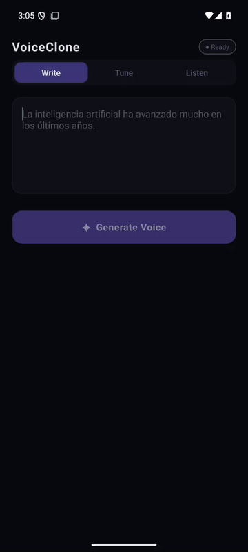

# Voice Clone Mobile

[](https://github.com/jonorl/voice-clone-mobile/actions/workflows/test.yml)
[](https://github.com/jonorl/voice-clone-mobile/security/code-scanning)
[](https://voice.jonathan-orlowski.dev/health)
[](LICENSE)

<p align="center">
  
</p>

The Android app for [Voice Clone](https://github.com/jonorl/voice-clone). Type some Spanish and it is spoken in the voice of my friend Pedro, using a Coqui XTTS v2 model I fine-tuned on his voice messages. It uses the same model API as the [web demo](https://jonathan-orlowski.dev/voice-clone/).

## Install

1. Download `voice-clone-<version>.apk` from the [latest release](https://github.com/jonorl/voice-clone-mobile/releases/latest) on your phone.
2. Open it. Android asks you to allow installs from that source the first time; it is under **Settings → Security → Install unknown apps**.
3. Open **Voice Clone** from the app drawer.

It needs Android 7.0 or later on an ARM phone, which is virtually every Android phone. Later releases install over it and keep it up to date.

If you installed a release from before 2.0.0, it shows up as **voice-clone-mobile** and stays separate, because the app's ID changed in 2.0.0. Uninstall it.

The app needs no permissions beyond internet access: it does not record audio, and it keeps the generated file in its own cache until you share it.

## How it works

The app has three steps:

- **Write:** type up to 1,000 characters of Spanish and generate.
- **Tune:** adjust the settings and generate again.
- **Listen:** play the result, or share or save it as a WAV file.

| Setting         | Range     | Effect                                                                           |
| --------------- | --------- | -------------------------------------------------------------------------------- |
| **Temperature** | 0.1 – 1.0 | Randomness in the prosody. Lower sounds steadier; higher sounds more expressive. |
| **Top-K**       | 1 – 100   | How many candidate tokens are considered at each step.                           |
| **Top-P**       | 0.1 – 1.0 | Nucleus sampling threshold. Lower values reduce variety.                         |
| **Seed**        | 0 – 999   | The same text, settings and seed give the same audio.                            |

On start-up the app asks the API's `/health` endpoint whether the model is ready, and only enables **Generate** when it is. Generating calls Gradio's HTTP API directly (`POST /gradio_api/call/generate_speech`, then reads the result as server-sent events) and downloads the WAV into the app's cache. The model runs on a CPU-only server and loads for each request, so a generation takes two to three minutes. The [Voice Clone README](https://github.com/jonorl/voice-clone#model) describes the model and its limitations.

## Project structure

```
├── app/index.tsx           # Expo Router entry point
├── api/gradioClient.ts     # Health check and the Gradio HTTP calls
├── hooks/
│   ├── useGenerate.ts      # Generates, downloads the WAV and tracks the server status
│   └── useAudioPlayback.ts # Playback through expo-audio
├── components/             # The three steps, the status pill and the sliders
├── constants/              # Colours and placeholder examples
├── plugins/                # Expo config plugin that adds release signing
└── styles/shared.ts        # Shared styles
```

## Tech stack

- **App:** React Native 0.88 and Expo SDK 58, with Expo Router, TypeScript and the React Compiler
- **Native modules:** expo-audio, expo-file-system, expo-haptics, expo-sharing and the community slider
- **Model API:** Coqui XTTS v2 behind Gradio and FastAPI, self-hosted; see [Voice Clone](https://github.com/jonorl/voice-clone)

## Getting started

You need Node.js 22 and, for a device build, the Android SDK and JDK 17.

```bash
npm install
npx expo start          # then press a for Android
```

The app calls the production model API, so nothing else needs to run. To build and install a release APK on a connected device or emulator:

```bash
npx expo prebuild --platform android
cd android && ./gradlew assembleRelease -PreactNativeArchitectures=x86_64   # arm64-v8a for a phone
adb install app/build/outputs/apk/release/app-release.apk
```

The generated `android/` folder is not committed; `app.json` is the source of truth for the native configuration.

## Testing

```bash
npm test                # Jest
npm run test:watch      # re-run on changes
npm run typecheck       # TypeScript
npm run lint            # ESLint
npx expo-doctor         # dependencies match the Expo SDK
```

The Jest suite covers the API client (the health check, the request it sends, both shapes of audio URL, the server's refusals and Gradio's errors) and the Write, Tune and status components, with the network mocked.

## Security and maintenance

- **CI:** the `Test` workflow runs on every push and pull request. It type-checks, lints and tests the app, and runs `expo-doctor`. The `Build APK` workflow builds a signed APK; see [Releasing](#releasing).
- **Branch ruleset:** changes to `main` go through a pull request with passing checks and no new high or critical CodeQL alerts. Force-pushes and deletion are blocked; repository admins can bypass.
- **CodeQL:** scans the TypeScript and the workflows weekly and on every pull request.
- **Permissions:** `app.json` blocks the microphone, shared storage and overlay permissions that Expo's template adds by default.
- **Dependabot:** security updates as soon as an advisory appears, and version updates every Monday for npm and monthly for GitHub Actions. Expo, React Native and the native modules are held back, because each Expo SDK pins them; they move together with `npx expo install --fix` when the SDK is upgraded. [`.github/dependabot.yml`](.github/dependabot.yml) lists them.
- **Override:** `package.json` forces zod 4 under `@expo/cli`, which still asks for zod 3, to pick up a security fix. The CLI only uses zod to validate dev-tools plugins, and those schemas work unchanged on zod 4. Remove the override once Expo moves to zod 4.
- **Secret scanning** with push protection is on.

## Releasing

1. Bump `version` (shown to people) and `android.versionCode` (one more than the last release; Android refuses to install a lower one over a higher one) in `app.json`.
2. Push to `main`, then push a matching tag:
   ```bash
   git tag v2.1.0 && git push origin v2.1.0
   ```
3. The `Build APK` workflow checks that the tag matches `app.json`, builds the APK, signs it and publishes a GitHub release with `voice-clone-<version>.apk` attached.

Running `Build APK` by hand from the Actions tab builds the same signed APK and keeps it as a workflow artifact for 14 days instead of releasing it.

### Signing

Every APK is signed with one release key, so each release installs over the last. The key is not in the repository: the workflow reads it from four repository secrets, and [`plugins/withReleaseSigning.js`](plugins/withReleaseSigning.js) adds it to the generated Gradle project. Without them, a local release build falls back to the debug key, which installs on an emulator but not over a real release.

| Secret                      | Holds                                  |
| --------------------------- | -------------------------------------- |
| `ANDROID_KEYSTORE_BASE64`   | The keystore file, base64-encoded      |
| `ANDROID_KEYSTORE_PASSWORD` | The keystore's password                |
| `ANDROID_KEY_ALIAS`         | The key's alias in it (`voice-clone`)  |
| `ANDROID_KEY_PASSWORD`      | The key's password                     |

If the key is lost, later APKs cannot install over the ones already out there, and everyone would have to uninstall and reinstall. Keep a backup of it outside GitHub.

## Ethical use

The voice belongs to a real person who agreed to this demo. Do not use it, or this code, to clone anyone's voice without their explicit permission, or to impersonate, defraud or deceive.

## Author

Developed by [Jonathan Orlowski](https://jonathan-orlowski.dev/). The code is licensed under the Apache License 2.0, see [`LICENSE`](LICENSE). The XTTS v2 model behind the API is under the [Coqui Public Model License](https://coqui.ai/cpml), which allows non-commercial use only.
